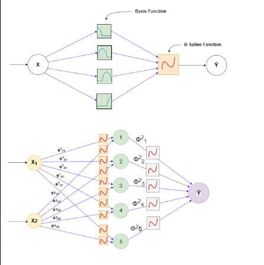

# AdaBoost–KAN for Breast Cancer Classification

Breast cancer remains a major global health concern, emphasizing the need for accurate and timely diagnosis. This study experimentally investigates the use of Kolmogorov–Arnold Networks (KANs) for breast cancer classification and evaluates their performance against widely used supervised learning methods. To further improve classification performance, Adaptive Boosting (AdaBoost) is integrated with KANs to form an ensemble model that focuses on misclassified instances during iterative learning.

The proposed AdaBoost–KAN model is evaluated using accuracy, precision, recall, and F1-score. Experimental results demonstrate strong and consistent classification performance with a compact model structure, while also providing interpretable feature-level insights. These findings highlight the potential of AdaBoost–KAN as an effective and interpretable approach for breast cancer diagnosis and clinical decision support.

## Project Overview

This repository contains the experimental study and implementation for comparing KAN-based and ensemble-based approaches for breast cancer classification. The main focus is on:

- evaluating Kolmogorov–Arnold Networks for medical diagnosis;
- comparing KAN performance with conventional supervised models;
- enhancing KAN using AdaBoost to improve decision boundaries;
- analyzing interpretability through feature-level behavior;
- reporting classification metrics relevant to clinical decision-making.

## Methodology

The workflow follows a standard supervised learning pipeline:

1. Load and preprocess the breast cancer dataset.
2. Train baseline models and KAN-based models.
3. Integrate AdaBoost with KAN to emphasize difficult examples.
4. Evaluate the models using accuracy, precision, recall, and F1-score.
5. Compare results and interpret model behavior.

## Model Architecture

The architecture of the KAN-based approach is shown below:



## Repository Structure

```text
KAN-Paper/
├── README.md
├── preview/
│   └── architecture.png
├── diagrams/
│   └── architecture.png
├── experiments/
│   └── Adaboost_MLP_VS_KAN.ipynb
└── .git/
```

## Experiment Notebook

The experimental study is implemented in:

- [experiments/Adaboost_MLP_VS_KAN.ipynb](experiments/Adaboost_MLP_VS_KAN.ipynb)

This notebook includes the comparative analysis between AdaBoost-enhanced KAN and conventional supervised learning baselines.

## Evaluation Metrics

The model is assessed using the following metrics:

- Accuracy
- Precision
- Recall
- F1-score

These metrics are essential in biomedical classification tasks where both false negatives and false positives may have serious clinical consequences.

## Key Findings

- AdaBoost–KAN achieves strong and consistent classification performance.
- The model remains compact while preserving predictive quality.
- The approach offers interpretable feature-level insights.
- It can serve as a useful tool for clinical decision support and early diagnosis.

## References

- Street, W. N., Wolberg, W. H., & Mangasarian, O. L. (1993). Breast cancer diagnosis and prognosis via linear programming.
- Liu, Z., et al. (2024). KAN: Kolmogorov–Arnold Networks.
- Freund, Y., & Schapire, R. E. (1997). A decision-theoretic generalization of on-line learning and an application to boosting.
- AdaBoost ensemble method as applied in machine learning classification tasks.

## Notes

This project is intended for research, experimentation, and educational use in machine learning and medical diagnosis applications.
